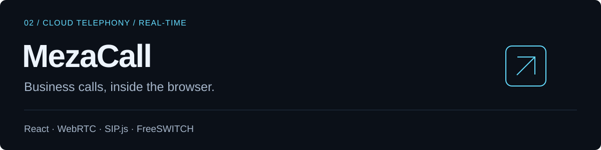

# MezaCall

A cloud telephony platform bringing browser-based calling, team workflows and call supervision into one workspace. Agent, supervisor and administrator experiences are organized by role and company.

**My role:** Freelance Full-Stack Developer  
**Author:** [Nizar Gassab](https://github.com/nizargassab)

[View project](https://mezacall.fr/) · [Portfolio case study](https://nizar-gassab-portfolio.vercel.app/projets/mezacall/) · [LinkedIn](https://www.linkedin.com/in/nizar-gassab-b872b5244/)

## What I worked on

### 1. Browser softphone

Integrated a React softphone using WebRTC and SIP.js connected to FreeSWITCH.

### 2. Agent and supervisor workflows

Developed real-time supervision, outbound campaigns, call history and access to recordings.

### 3. Company and role boundaries

Worked on PostgreSQL-backed access controls that distinguish each company and the responsibilities of agents, supervisors and administrators.

## Technology stack

| Area | Technologies |
| --- | --- |
| Web experience | React, TypeScript |
| Telephony | WebRTC, SIP.js, FreeSWITCH |
| Application environment | Laravel, PostgreSQL, Docker |

## Product flow at a glance

**Agent workspace → Browser softphone → Call events → Supervisor view**

## Explore further

- [Public project reference](https://mezacall.fr/)
- [Project details](https://mezacall.fr/telephonie-centre-appels)
- [All selected work](https://nizar-gassab-portfolio.vercel.app/#projets)

---

This repository is a public project showcase documenting my contribution. Application source code is maintained separately. The overview describes the project scope; it does not contain client data, deployment configuration or credentials.
